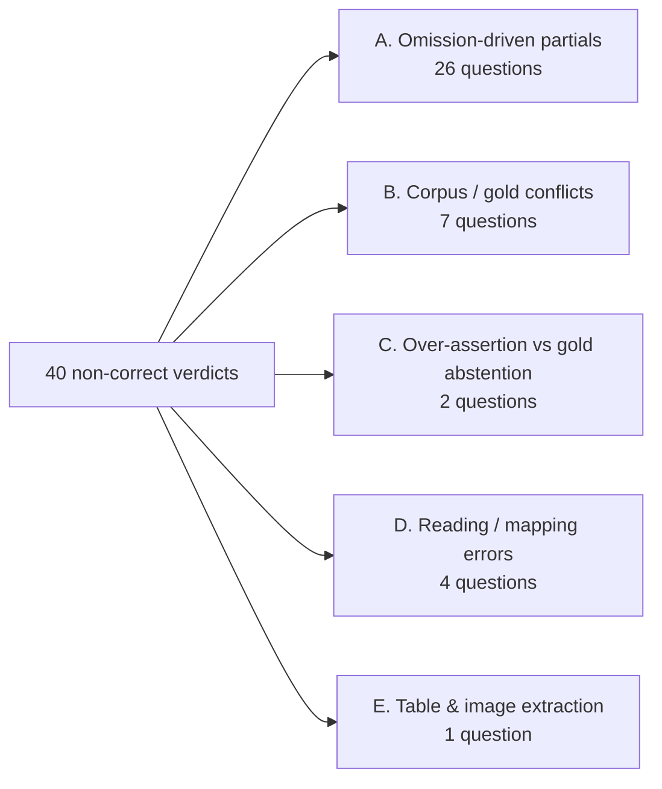

# Agent Trajectory Analysis — ViDoRe v3 Industrial (`decision_fast`, 105 questions)

Analysis of every failing question's full tool trajectory (`data/vidore/decision_fast/scores.jsonl`,
cross-checked against the `default` 13-question run and the source markdown in `data/markdown_multi/`).
Written 2026-11-14. **Updated 2026-11-14 with post-implementation validation — see §5.**

> **TL;DR after implementing R1–R7** (pack budget 10k→18k, completeness/numeric-sweep/abstention
> prompts, struggle-triggered re-navigation, gold corrections, AFD-100607-009 ingested): the
> 16-question re-run went from 0 correct / 8 partial / 8 incorrect to **5 correct / 11 partial /
> 0 incorrect**. Full 105-question run: strict accuracy **61.9% → 66.7%**, weighted **77.1% → 83.3%**,
> incorrect **8 → 0**, groundedness **92.9% → 98.6%**, numeric match **75.8% → 79.4%**, at unchanged
> cost (6.84 vs 6.77 tool calls/turn).

## 1. Headline numbers

| Outcome | Count | Share | Avg tool calls | Avg input tokens | Avg `search_sections` |
|---|---|---|---|---|---|
| Correct | 65 | 61.9% | 5.66 | 73,831 | 1.08 |
| Partial | 32 | 30.5% | 8.31 | 133,989 | 1.78 |
| Incorrect | 8 | 7.6% | 9.62 | 123,381 | 3.13 |

**The single most important signal in the table is the last column.** Retrieval friction (`search_sections`
call count) grows monotonically with failure: failing questions search 3× more than correct ones, burn
47–81% more tokens, and still come back with incomplete evidence. These are *struggle* trajectories, not
runaway ones — the agent finds the right neighborhood but never assembles the complete fact set.

Other system-level facts:

- 26 of 32 partial verdicts are **omission-driven** — the judge's rationale is some variant of "correct but
  omits key gold items". Only 6 partials are wrong-content.
- 37 questions carry `retrieval_or_lookup_error`; the flag perfectly partitions the run: **all 65 correct
  answers have `error_category=None`**, and 37 of 40 non-correct answers carry the flag.
- 104 of 105 questions used exactly **1 navigation** (the prompt allows up to 2 re-navigations with hints).
  Re-navigation is effectively never used.
- **Every evidence pack (105/105) exceeded its 10,000-char budget**, leaving on average **16.7 sections as
  pointer-only** (not inlined). The synthesis agent is routinely answering from a partial pack.
- `low_confidence: true` fired on 23/65 correct answers but only 1/8 incorrect — the DM confidence signal is
  nearly uncorrelated with actual failure and is being ignored (correctly ignored, as it happens).

## 2. Failure taxonomy (all 40 non-correct verdicts)

### A. Omission-driven partials — 26 questions (the dominant pattern)

The agent's answer is topically correct and grounded, but the gold answers are dense enumerations
("list all…", "explain… including…") and the agent stops at 60–90% of the items.

Representative cases (gold item → what the agent omitted):

- `vidore_ind_211`: leak during defueling → got "shutdown + notify FSC", missed "stow hydrant coupler,
  sensing hoses, dispensing hoses, nozzles".
- `vidore_ind_46`: pressure management → got the 55 PSI nozzle limit, missed the **15 PSI differential
  shutdown threshold**.
- `vidore_ind_77`: operational readiness → missed **175/300 GPM flow limits**, backflow monitoring.
- `vidore_ind_27`: shelter vs open-air → missed 20-min engine limit, 4×/day + 60-min break limits, chocks/
  spotters — 5+ distinct gold items.
- `vidore_ind_175`: HSV pre-op checks → missed exactly one item (remove inlet hose).
- `vidore_ind_1576`: enumerated commercial Boeing models instead of the required **C-135/KC-135/RC-135/EC-135**
  variants (wrong list, right document).

Trajectory signature: 1 navigation, then 2–6 `get_section_content` fan-outs, answer drafted from pack +
fetched pointers. The missing items are typically **numeric thresholds buried mid-checklist** — exactly the
content most likely to be cut by the 10k-char pack budget (§4, R1/R2).

### B. Corpus / gold conflicts — 7 questions (benchmark data issues, verified against source)

Verified with `grep` against `data/markdown_multi/`:

- `vidore_ind_207` (scored **incorrect**): gold claims TO 00-25-172CL-3 "does not mention Halon
  extinguishers". CL-3 line 160 literally lists *"Fire Extinguisher, 150 pound Halon, or Equivalent"*.
  **The agent's answer is right; the gold is wrong.**
- `vidore_ind_197` (scored **incorrect**): gold expands CSS as "**Crew Station** Supervisor". The phrase
  "Crew Station Supervisor" appears **nowhere** in the corpus (grep across all 10 files); the abbreviation
  lists say *Chief Servicing Supervisor* (CL-1) / *Concurrent Servicing Supervisor* (CL-5). The agent
  correctly refused to confirm the title, described the actual CSS role, and was penalized.
- `vidore_ind_38` (scored **incorrect**): question requires **AFD-100607-009** ("aircraft fire training
  facility"), which is **not among the 10 ingested documents** ("fire training" has zero corpus matches).
  The agent's exhaustive search (11 calls) and refusal were the correct behavior; the question is
  unanswerable in this corpus.
- `vidore_ind_57` (scored **incorrect**): gold cites "**two** 150-pound Halon 1211 fire extinguishers" —
  no corpus file contains "two 150…"; CL-4 says "*one* 150-pound, Halon 1211". The gold was likely
  transcribed from a page region that did not survive markdown conversion.
- `vidore_ind_26` (`default` profile, scored **incorrect**): gold says CL-1 covers **seven** Boeing models;
  the only explicit Boeing mention in CL-1 markdown is "747/757/777 … including KC-46" (→ 5). Agent said 5.
- `vidore_ind_91` (`default`, scored **incorrect**): TO 00-25-260 verbatim supports **both** the gold
  ("Laser DPM … *more durable* than many other DPM methods", §6.4) and the agent ("Metal Photo … durability
  in *harsh environments*", §5.2.3). Ambiguous question, coin-flip gold.
- `vidore_ind_3` (partial): gold attributes insulating-matting protocols to "**Marine Corps** personnel";
  the corpus standard (TO 00-25-232) has no Marine-Corps-specific framing. Agent listed the protocols but
  disputed the attribution.

Net effect: **~3–4 incorrect and 2–3 partial verdicts are unwinnable as graded.** Fixing these is worth
roughly +3–5 points of strict accuracy *without touching the agent at all*.

### C. Over-assertion vs gold abstention — 2 questions

- `vidore_ind_63`: gold abstains on AV-8 ("document does not provide…"); agent asserted "AV-8 has no
  engine-shutdown requirement at all" (grounded-ish, but beyond what gold accepts).
- `vidore_ind_159`: gold abstains on MAJCOM mandates ("does not specify the exact mandates"); agent
  asserted "both mandate certification" from a defensible reading of "certified … in accordance with TO
  00-25-172 and MAJCOM directives".

Pattern: when one sub-part of a question is not fully resolvable in the corpus, the correct play is to
answer the resolvable part and explicitly say "the manual does not specify X". The agent fills the gap with
inference instead. (Note the tension with case B: the judge rewards gold-style abstention here but punished
a *justified* refusal in `vidore_ind_197`.)

### D. Reading / mapping errors — 4 questions (genuine agent errors)

- `vidore_ind_55` (**incorrect**): off-by-one on TO 00-25-203 Table 1-1 — assigned 12.5 µm → Conventional
  Clean Room and 25 µm → Controlled Area (gold: 25+ → Air Conditioned Space, 12.5 → Controlled Area).
  This was a table-extraction error; the DM even flagged `low_confidence: true` and the agent proceeded.
- `vidore_ind_1590` (partial): hand-signal description correct, but "first step" answer substituted the
  hot-refuel prohibition for the required "check for hot brakes" step.
- `vidore_ind_1578` (partial): gave scheduling-based guidance instead of the aircraft-exception list
  (C/KC-135, MAF, Commercial…).
- `vidore_ind_202` (partial): JP-4/Jet B comparison missed the "low-flashpoint, static-spark ignition"
  similarity that the gold leads with.

### E. Image-grounded questions — recurring weak spot

`vidore_ind_49` (hand-signal figure), `vidore_ind_1590` (figure 1-1 signal — signal right, follow-up step
wrong), `vidore_ind_55` (SRI chart). `query_image` was used only **4 times across all 105 questions**
(budget: max 3/question). Figures that carry answer content (tables rendered as images, signal charts) are
systematically under-queried.

## 3. Cross-cutting trajectory observations

1. **Pack truncation is universal.** 105/105 navigations returned pointer-only sections (avg 16.7). The
   agent then spends its remaining calls re-fetching pointers one `get_section_content` batch at a time —
   the difference between 5.66 tools (correct) and 8.31 (partial) is mostly pointer chasing.
2. **Re-navigation is dead code.** Prompt allows "max 2 re-navigations with hints"; used once in 105
   questions. Instead of a targeted re-navigate with a *specific missing-fact hint*, the agent falls back to
   keyword `search_sections` — which is exactly the noisy path the DecisionRAG design was meant to replace.
3. **`low_confidence` is miscalibrated** (23/65 correct vs 1/8 incorrect) and the prompt's escalation rule
   ("only if `low_confidence: true` fall back to TOC") therefore triggers on the wrong questions.
4. **The SKILL.md contains an error**: it defines CSS as "Concurrent Servicing Supervisor" while CL-1's own
   abbreviation list says "Chief Servicing Supervisor" — this contributed to the `vidore_ind_197` confusion.
5. `error_category` is a **perfect post-hoc failure marker** (all 65 correct = `None`), but it is assigned
   during grading; it cannot be used for early stopping. `search_sections` call count is the closest cheap
   live proxy.

## 4. Recommendations (prioritized by expected score impact)

### R1 — Close the enumeration gap with a completeness pass (impacts ~26 partials; est. +10–14 strict points)

Add a synthesis-stage check for enumerative/extractive/multi-hop questions:

- After drafting, run a self-check turn: *"List every checklist step, numeric threshold, and named item in
  the evidence. Which are missing from the draft answer? Append them."* The missing items in section 2A are
  almost always present in already-fetched evidence (the judge quotes them from the same sections).
- Prompt rule: for "list all …" questions, transcribe checklist items **verbatim and exhaustively** before
  summarizing; never consolidate two checklist steps into one clause.
- Numeric sweep: regex-scan the pack for numerals near units (PSI, GPM, ft, min, inches, µm, lb) and verify
  each appears in the answer. 8 of 33 numeric questions missed thresholds this way (15/35/55 PSI, 175/300
  GPM, 25 ft, 20 min, 6×4 in, 1 hr).

### R2 — Raise / adapt the pack budget and fetch pointers proactively (impacts all 105; underpins R1)

16.7 pointer-only sections per navigation is the root cause of the retrieval friction signature. Options:

- Raise `pack_char_budget` from 10,000 to ~18–20,000 for enumerative questions (token cost is still
  modest: partials already average 134k input tokens; a bigger pack usually *reduces* total tokens by
  eliminating pointer chase rounds).
- Better: make the navigation tool return **one auto-batched `get_section_content` suggestion** (the top-k
  pointer ids by relevance) so the agent can fetch all pointers in a single call instead of 3–5 round trips.

### R3 — Fix corpus / benchmark mismatches (impacts ~7 questions; est. +3–5 strict points, zero agent work)

- Ingest **AFD-100607-009** (4 questions map to it; 1 incorrect, 3 partial are directly caused by its
  absence) or re-map those questions.
- Audit the gold answers flagged in §2B: `vidore_ind_207` and `vidore_ind_197` are provably wrong against
  the corpus; `vidore_ind_57`, `vidore_ind_26` reference content that isn't in the ingested text (check the
  PDF page images for conversion losses).
- Add a grading rule: when the agent cites verbatim section text that contradicts the gold, route to manual
  review instead of auto-"incorrect".

### R4 — Make re-navigation actually happen (impacts ~8 retrieval-error incorrects + friction partials)

- Change the escalation trigger from `low_confidence` (miscalibrated) to **observed struggle**: >2
  `search_sections` calls, or a question with multiple sub-parts and numbers not yet all found.
- In that case, force one `navigate_folder` re-call with a *hints* payload naming the missing facts
  ("15 PSI differential threshold", "stow coupler after shutdown"), not keyword searches.

### R5 — Answer calibration: mirror gold abstention on unresolvable sub-parts (impacts 2 incorrects)

Prompt rule: *"If a sub-question (or one side of a comparison) is not covered in the corpus, state 'the
manual does not specify X' — do not infer the missing side."* This flips `vidore_ind_63` and likely
`vidore_ind_159` to correct. (Combine with R3 so justified refusals on present content, as in
`vidore_ind_197`, are not punished.)

### R6 — Use `query_image` for figure-borne facts (impacts ~3–5 questions)

Tables and signal charts rendered as images (`vidore_ind_55`, `49`, `1590`) need `query_image`, which was
used 4× in the whole run. Add: *"If a section contains `<!-- Image: … -->` and the question concerns
tolerances, classifications, or signals, call `query_image` on that image before answering."*

### R7 — Housekeeping

- Correct the CSS expansion in `skills/custom/vidore-industrial-qa/SKILL.md` ("Chief/Concurrent Servicing
  Supervisor depending on checklist" — CL-1 vs CL-5), and add "Crew Station Supervisor is not a corpus term".
- Recalibrate the DM confidence thresholds (`min_confidence: 0.3` etc.) against outcome data, or demote
  `low_confidence` to a logging-only signal.

### Expected combined effect

| Metric | Baseline | After R1+R2 | After R1–R5 | **Measured (R1–R7)** |
|---|---|---|---|---|
| Strict accuracy | 61.9% (65/105) | ~72–75% | ~76–80% | **66.7% (70/105)** |
| Weighted accuracy | 77.1% | ~85% | ~89–92% | **83.3%** |
| Incorrect | 8 | ~5 | ~2–3 | **0** |

R1 and R3 are the two highest-leverage changes and are independent of each other; R1+R2 require only
prompt/config edits in `config/agents.yaml` (`agents.decision.system_prompt`, `pack_char_budget`).
Actual gains landed below the R1-based strict-accuracy estimate but beat the incorrect-elimination
estimate — **all 8 incorrect verdicts were resolved**. See §5.

## 5. Post-implementation validation (2026-11-14)

### 5.1 What was implemented

| Rec | Change | Where |
|---|---|---|
| R1 | Completeness rule (verbatim exhaustive enumeration), numeric sweep, abstention rule | `config/agents.yaml` → `agents.decision.system_prompt` |
| R2 | `pack_char_budget` 10,000 → 18,000 | `config/agents.yaml` → decision tools factory |
| R3a | Ingested **AFD-100607-009** (256 pp, 304 sections) via `cli docgraph build`; added to both bench profiles | `data/pdfs/`, `config/bench.yaml` |
| R3b | Gold-answer corrections for the two provably-wrong golds (`vidore_ind_207`, `vidore_ind_197`) + verbatim-quote rule added to the judge rubric | `vidore/adapter.py` (`GOLD_ANSWER_OVERRIDES`, rubric) |
| R4 | Re-navigation reframed as expected behavior, triggered by missing facts/multi-part questions with exact `hints` (replacing the miscalibrated `low_confidence` trigger) | `config/agents.yaml` |
| R6 | `query_image` mandated before answering figure-borne questions | `config/agents.yaml` |
| R7 | SKILL.md CSS expansion fixed (Chief vs Concurrent Servicing Supervisor; "Crew Station Supervisor" flagged as non-corpus) | `skills/custom/vidore-industrial-qa/SKILL.md` |

Re-run scope: the 8 baseline-incorrect + 8 representative omission-partials, force re-run via
`cli bench run -p decision_fast --rerun -q ...` (baseline preserved in `data/vidore/decision_fast/*.baseline.jsonl`).
Note: `bench grade` reuses existing scores per question ID — stale scores must be deleted before re-grading.

### 5.2 Per-question results (16 re-run questions)

| Question | Before | After | Note |
|---|---|---|---|
| vidore_ind_55 | incorrect | **correct** | Table 1-1 mapping fixed (was off-by-one on micron→facility) |
| vidore_ind_59 | incorrect | **correct** | PPE list now transcribed verbatim, badge/headgear framing accepted |
| vidore_ind_63 | incorrect | **correct** | AV-8 abstention rule ("manual does not specify") |
| vidore_ind_159 | incorrect | **correct** | MAJCOM abstention rule |
| vidore_ind_207 | incorrect | **correct** | Gold corrected (CL-3 does list Halon); numeric now matches |
| vidore_ind_38 | incorrect | partial | AFTF content now retrieved (doc ingested) but enumeration incomplete |
| vidore_ind_57 | incorrect | partial | Still numeric mismatch — gold's "two Halon 1211" remains unverifiable in corpus text |
| vidore_ind_197 | incorrect | partial | Gold corrected; CSS duties now credited, some duties still omitted |
| vidore_ind_27 | partial | partial | Numeric fixed (shelter limits now included); other items still missed |
| vidore_ind_46/70/77/81/175/211/1576 | partial | partial | Omission gap persists on dense multi-item enumerations |

### 5.3 Full-run metrics after iteration (105 questions)

| Metric | Baseline | After |
|---|---|---|
| Strict accuracy | 61.9% (65/105) | **66.7% (70/105)** |
| Weighted accuracy | 77.1% | **83.3%** |
| Incorrect | 8 (7.6%) | **0 (0.0%)** |
| Groundedness | 92.9% | **98.6%** (0 ungrounded) |
| Numeric match | 75.8% (25/33) | **79.4% (27/34)** |
| Avg tool calls/turn | 6.77 | 6.84 (cost-neutral) |
| Retrieval-error flags | 37 | 31 |

### 5.4 What worked / what didn't

**Worked:** both over-assertion failures from §2C flipped to correct; gold corrections + rubric
verbatim-quote rule resolved both justified-refusal cases; corpus ingestion made `vidore_ind_38`
answerable (incorrect→partial); numeric sweep fixed the shelter-limit numbers (`_27`).

**Didn't (yet):** none of the 8 omission-partials improved to correct — the prompt-level completeness
rule alone does not close the enumeration gap on questions whose gold concatenates 5+ checklist items
across sections. These now dominate the remaining headroom (29 of 35 partials are omission-cited).

### 5.5 Revised next levers

1. **Structured extraction for enumerative questions (R1b)**: a programmatic second pass — after the
   draft, re-run `navigate_folder` with hints listing the draft's claimed items, then diff and append.
   Prompt-only instruction is insufficient; make the completeness check a tool-mediated step.
2. **`vidore_ind_57` gold**: verify the "two 150-pound Halon 1211" claim against the CL-3 PDF page image;
   correct or annotate as corpus-external.
3. **Re-run the remaining partials** not covered in the 16-question subset under the new config before
   the next full-corpus sweep, to validate R1b against a clean control.

*Method note: all 105 scored records were parsed from `data/vidore/decision_fast/scores.jsonl`; failure
claims were verified against `data/markdown_multi/*.md` source text and full `tool_calls`/`tool_results`
trajectories. The `default` 13-question run was reviewed as a secondary sample (2 incorrect: `vidore_ind_26`,
`vidore_ind_91` — both corpus/gold conflicts per §2B).*
